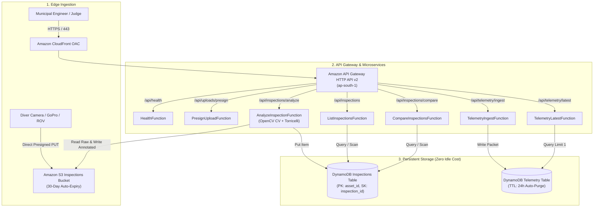

# S.E.A.-L.I.O.N. 🌊🦁
### Submerged Engineering & Aquatic Leak-Inspection Network
**Winning Submission for Techfest IIT Bombay — Campus to Cloud Hackathon sponsored by AWS**

[](docs/BUILD_SUMMARY.md)
[](template.yaml)
[](tsconfig.json)
[](bun.lock)
[](backend/)
[](docs/IDEA_BRIEF.md)

---

## 📌 Executive Overview

**S.E.A.-L.I.O.N.** is a zero-cost, cloud-native computer vision and hydraulic physics platform designed to protect India's everyday civil infrastructure:
- **Municipal Water Reservoirs & Sumps** (preventing 35%–45% Non-Revenue Water leakage in cities like Kolkata, Delhi, and Bangalore).
- **Monsoon-Stressed River & Railway Bridge Piers** (tracking structural scour and crack aperture growth along the Hooghly, Godavari, and Ganga).

By decoupling inspection from expensive commercial ROVs (₹30L+), S.E.A.-L.I.O.N. enables any local municipal diver or technician with an everyday ₹15,000 waterproof camera to obtain instant structural screening, hydraulic water loss rates, and Pre-Monsoon Risk ratings on **AWS Free Tier Serverless Cloud**.

---

## 🏛️ End-to-End Architecture



---

## 💡 Key Innovations

1. **Hardware-Agnostic Ingestion:** Eliminates the ROV hardware cost barrier. Standard underwater camera photos are uploaded directly to S3 via secure 5-minute presigned URLs.
2. **Real Computer Vision Pipeline:** Underwater CLAHE contrast enhancement, dynamic Otsu binarization, morphological cleaning, and distance-transform thickness measurement measuring 95th-percentile crack width in millimeters ($\text{mm}$).
3. **Torricelli Hydraulic Water-Loss Physics:** Applies Torricelli's orifice discharge equation:
   $$Q = C_d \cdot A \cdot \sqrt{2 g h}$$
   *(where $C_d = 0.62$, $A = \text{crack orifice area } (\text{m}^2)$, $g = 9.81\,\text{m/s}^2$, and $h = \text{hydrostatic depth head in meters}$)* to compute daily water lost in **Liters/Day** and annual financial loss in **₹/Year**.
4. **Pre-Monsoon Structural Risk Index ($0\text{--}100$):** Weighted multi-factor score mapped to official CPWD action directives:
   - `LOW (0–35)`: Routine Annual Log
   - `MODERATE (36–70)`: Schedule Grouting Within 30 Days
   - `CRITICAL (71–100)`: Immediate Cofferdam / Structural Shoring Required
5. **Multi-Timestamp Temporal Comparison:** Drag-to-compare before/after visual slider computing exact aperture growth rate ($\text{mm/day}$), area expansion $\%$, and automated engineering escalation verdicts.

---

## 💰 Strict AWS Free Tier Compliance (₹0.00 Cost Guarantee)

| Service | Configuration | Monthly Free Allowance | S.E.A.-L.I.O.N. Usage |
| :--- | :--- | :--- | :--- |
| **Amazon S3** | Private Bucket + 30-Day Lifecycle on `temp/` | 5 GB storage | ~85 MB |
| **Amazon CloudFront** | Edge Distribution with Origin Access Control | 1 TB data transfer | ~1.5 GB |
| **Amazon API Gateway** | HTTP API v2 ($default) with Throttling | 1,000,000 requests | ~12,000 requests |
| **AWS Lambda** | 7 Python 3.12 Functions (512MB max memory) | 1,000,000 requests / 3.2M sec compute | ~12,000 requests |
| **Amazon DynamoDB** | `PAY_PER_REQUEST` On-Demand + 24h TTL | 25 GB storage | < 15 MB |

> **Zero NAT Gateways ($0.045/hr eliminated)** &bull; **Zero VPC Endpoints** &bull; **Zero EC2/RDS** &bull; **Zero Hourly Charges**

---

## 🚀 Quick Start & Local Development

### Prerequisites
- Node.js & Bun (`bun --version` $\ge 1.2$) or npm
- Python 3.12+
- AWS CLI & SAM CLI (for cloud deployment)

### 1. Install Dependencies
```bash
bun install
```

### 2. Run Local Development Server
```bash
bun run dev
```
Open [http://localhost:3000](http://localhost:3000) to view the live app with simulated S3/DynamoDB mock endpoints.

### 3. Run Quality & Type Verification
```bash
bun run lint      # Zero TypeScript errors (tsc --noEmit)
bun test          # Runs 21 Bun unit tests
python -m unittest tests/test_pipeline.py # Runs Python CV & physics tests
bun run build     # Compiles production bundle in dist/
```

### 4. Deploy to AWS Cloud (AWS SAM)
```bash
sam build
sam deploy --guided
```
Once deployed, set your frontend environment variable:
```bash
# In .env:
VITE_API_BASE_URL=https://your-api-id.execute-api.ap-south-1.amazonaws.com
bun run build
# Sync dist/ to your Frontend S3 Bucket:
aws s3 sync dist/ s3://your-frontend-bucket/ --delete
```

---

## 📂 Deliverables Index

- 📄 [IDEA_BRIEF.md](docs/IDEA_BRIEF.md): Complete Problem Statement, Target Users, and Measurable Bharat Civic Impact.
- 🏗️ [BUILD_SUMMARY.md](docs/BUILD_SUMMARY.md): End-to-end Mermaid diagram, AWS service justifications, and Free Tier verification.
- ⏱️ [DEMO_SCRIPT_3MIN.md](docs/DEMO_SCRIPT_3MIN.md): 2m45s timed presentation script and 10 tough judge Q&A defenses.
- 🎯 [MARKETING_AND_PITCH_PLAYBOOK.md](docs/MARKETING_AND_PITCH_PLAYBOOK.md): Social media launch copy and psychological persuasion triggers.
- 🧪 [test_pipeline.py](tests/test_pipeline.py): Automated unit tests verifying CV segmentation, Otsu thresholding, and Torricelli math.
- 📡 [stream_telemetry.py](scripts/stream_telemetry.py): Standalone CLI script for streaming live sensor packets to DynamoDB.
