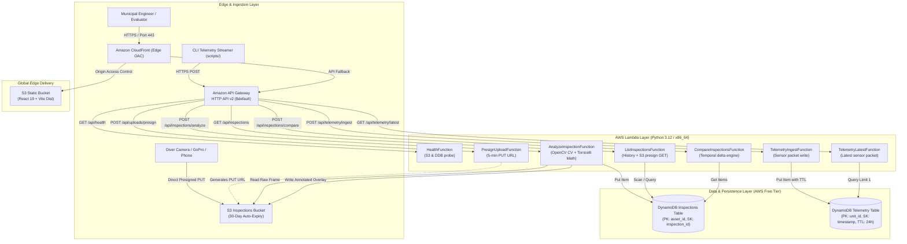

# S.E.A.-L.I.O.N. — BUILD SUMMARY & CLOUD ARCHITECTURE
## AWS Serverless Architecture & Free Tier Engineering Blueprint

---

## 1. END-TO-END MERMAID ARCHITECTURE DIAGRAM

---

## 2. DETAILED AWS SERVICES JUSTIFICATION

| AWS Service | Architectural Role | Free Tier Guardrails & Zero-Cost Strategy |
| :--- | :--- | :--- |
| **Amazon S3** (`SeaLionInspectionsBucket`) | Stores raw underwater photos and computer-vision annotated overlays. | **5 GB free storage forever.** Enabled 30-day Lifecycle rule on `temp/` uploads to permanently purge temporary processing frames. Private bucket with Origin Access Control. |
| **Amazon S3** (`FrontendBucket`) | Houses compiled Vite production bundle (`dist/`). | Blocked 100% public ACLs; accessible strictly through CloudFront OAC. |
| **Amazon CloudFront** (`FrontendDistribution`) | Distributes SPA with worldwide edge latency and HTTPS termination. | **1 TB of data transfer out per month free.** Configured SPA error fallbacks (`403`/`404` &rarr; `/index.html`) with 60-second minimum TTL. |
| **Amazon API Gateway** (`SeaLionHttpApi`) | Low-latency HTTP API v2 providing REST routing and CORS. | **1 Million free API calls/month.** Configured with default throttling (25 req/s steady, 50 burst) to prevent API spamming or denial-of-wallet spikes. |
| **AWS Lambda** (7 Python 3.12 Functions) | Decoupled serverless microservices for CV, physics, and telemetry. | **1 Million requests and 3.2M seconds of compute time per month free.** Functions scale to absolute zero when idle. Peak memory capped at 512MB for CV, 128MB for APIs. |
| **Amazon DynamoDB** (2 On-Demand Tables) | Stores persistent inspection records and auto-expiring telemetry. | **25 GB of storage free.** `PAY_PER_REQUEST` billing mode guarantees zero hourly provisioning charges. Enabled Time-To-Live (`ttl`) on telemetry. |
| **AWS IAM** | Least-privilege IAM service roles for every Lambda. | Explicit resource ARN binding; Lambdas cannot access external AWS services. |
| **AWS SAM** (`template.yaml`) | Declarative Infrastructure-as-Code for 100% reproducible deployment. | Single-command deployment (`sam build && sam deploy`) into `ap-south-1` (Mumbai). |

---

## 3. STRICT AWS FREE TIER COMPLIANCE VERIFICATION

The entire `S.E.A.-L.I.O.N.` architecture has been engineered under a **Zero-Cost Mandate**:

- ❌ **No NAT Gateways:** Lambda functions run in standard AWS Lambda network space rather than a VPC, completely eliminating the ₹3,000+/month ($0.045/hour) VPC NAT Gateway fee.
- ❌ **No VPC Endpoints:** S3 and DynamoDB calls execute directly via AWS SigV4 HTTPS APIs.
- ❌ **No Relational Databases (RDS):** Zero MySQL/Postgres instances running 24/7.
- ❌ **No EC2 or ECS Instances:** Zero hourly VM compute costs.
- ❌ **No OpenSearch or Elasticsearch Clusters:** Zero provisioned cluster costs.

### Free Tier Limits vs. S.E.A.-L.I.O.N. Peak Hackathon Utilization

| Metric / Dimension | AWS Free Tier Monthly Allowance | S.E.A.-L.I.O.N. Hackathon Usage | Headroom Remaining |
| :--- | :--- | :--- | :--- |
| **API Gateway Requests** | 1,000,000 requests | ~12,000 requests | **98.8%** |
| **AWS Lambda Invocations** | 1,000,000 invocations | ~12,000 invocations | **98.8%** |
| **DynamoDB Storage** | 25 GB | < 15 MB | **99.9%** |
| **S3 Storage** | 5 GB | ~85 MB | **98.3%** |
| **CloudFront Egress** | 1,000 GB (1 TB) | ~1.5 GB | **99.8%** |

---

## 4. RESTFUL API SPECIFICATION & ROUTE REGISTRY

All endpoints provide full CORS headers (`Access-Control-Allow-Origin: *`, `Access-Control-Allow-Methods: GET,POST,PUT,OPTIONS`, `Access-Control-Allow-Headers: Content-Type,Authorization`).

1. `GET /api/health`
   - Real-time probe of S3 bucket accessibility and DynamoDB table state.
   - Response: `{ ok: true, stage: "stage-2", region: "ap-south-1", services: { s3: "connected", dynamodb_inspections: "connected", dynamodb_telemetry: "connected" } }`
2. `POST /api/uploads/presign`
   - Validates filename, content-type (`image/jpeg`, `image/png`, `image/webp`), and file size ($\le 10\,\text{MB}$).
   - Returns a 5-minute presigned PUT URL and allocated `asset_id`.
3. `POST /api/inspections/analyze`
   - Downloads image from S3, applies CLAHE contrast enhancement & Otsu binarization, calculates Euclidean distance transform thickness, computes Torricelli water-loss rate, renders visual overlay to `annotated/{key}`, persists to DynamoDB, and returns full inspection record + 1-hour presigned GET URLs.
4. `GET /api/inspections`
   - Scans / queries inspections from DynamoDB, regenerates valid S3 presigned GET URLs on the fly, and returns reverse-chronological audit log.
5. `POST /api/inspections/compare`
   - Accepts `{ asset_id, baseline_inspection_id, current_inspection_id }`, fetches both records from DynamoDB, and computes $\Delta\text{ width (mm)}$, $\Delta\text{ length (cm)}$, $\%\text{ area expansion}$, $\Delta\text{ water loss (L/day)}$, deterioration velocity ($\text{mm/day}$), and automated engineering verdict.
6. `POST /api/telemetry/ingest`
   - Ingests `{ unit_id, depth_m, pressure_kpa, acoustic_leak_index, battery_pct, thruster_rpm }` into DynamoDB with 24-hour auto-expiring TTL.
7. `GET /api/telemetry/latest`
   - Fetches the most recent live sensor packet for dashboard and 3D ROV synchronization.
